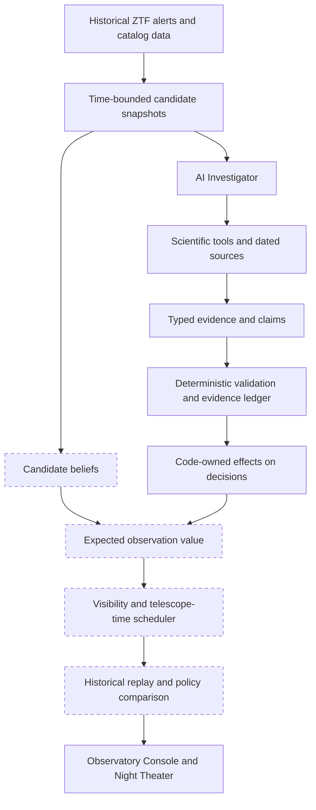

# Cosmic Triage

**Cosmic Triage investigates astronomical transients using grounded AI agents to determine which objects deserve limited telescope follow-up time.**

### Can a grounded AI investigator make better decisions about where to point a telescope?

Astronomical surveys surface more transient candidates than a follow-up telescope can observe. Some are newly exploding stars. Others are variable galaxies, stars, asteroids, or artifacts. A promising target might already have been classified by another team. The difficult question is not just **what is this object?** It is **which observation is worth spending limited telescope time on, given what was known at that moment?**

Cosmic Triage is a learning-driven engineering project exploring that question with historical observations from the Zwicky Transient Facility (ZTF). It is being built to combine a tool-using AI Investigator, evidence validation, probabilistic decision-making, observation scheduling, and an interactive replay of a night at Palomar Observatory.

The broader engineering objective is to measure whether **typed, tool-using agents improve decisions over simpler approaches**, such as rules, broker scores, and non-agent baselines, once evidence quality, reliability, and inference cost are accounted for. The system is a research prototype. It does **not** control a physical telescope and makes no claim of new astronomical discovery.

> **Current stage: Investigator v1 implemented and running in deterministic, exploratory mode.** Historical replay and the Observatory Console run on real ZTF data. The Claude and Jev integrations are implemented behind feature flags but have **not yet been exercised with live paid model calls**. The scheduler and the comparative benchmark are next, so there are **no benchmark results yet**. See [Project status](#project-status).

## See it in action


*Night Theater: scrub through a historical night at Palomar to see candidates move across the sky, twilight and Moon, and which targets clear the 30° altitude limit.*


*Candidate Explorer: each candidate's light curve and the information available at the historical decision time t. Circles are detections; triangles are non-detection limits (lower magnitude = brighter).*

These screenshots come from the early S0 console, captured before the M1.1 replay-integrity fixes. Candidate counts have since changed: the 2025-04-19 pool shown here had 95 candidates and now has 79. The current console also has an **Investigations** tab. The telescope is simulated; the ZTF observations are historical.

## How it works



*Dashed boxes are planned for M3–M4. Beliefs are currently an uncalibrated stub; the only implemented decision effect is the spectrum-reward adjustment for objects already classified at t.*

**The AI does not get to invent a probability or directly command a telescope.** Models can decide *what to investigate*, call tools, and propose evidence-backed claims. Before an accepted claim can influence a decision, deterministic code checks:

- provenance
- dates
- object associations
- claim structure

The scientific decision layer owns probabilities, reward calculations, and scheduling.

A key design constraint is **historical information availability**. An observation made before a simulated decision is not necessarily usable: it might only have been delivered in a later alert. The replay distinguishes when a measurement was taken from when an alert made it available. This matters because an apparent improvement from an AI system is meaningless if it secretly saw the future. Adversarial leakage fixtures (`tests/leakage/`) check this boundary on every test run.

## The Investigator

Investigator v1 includes:

- **Six typed scientific tools.** Each filters its output to what was known at the replay time t:
  - alert history
  - classification-report lookup
  - Lasair/Sherlock host context
  - SIMBAD cone search
  - ALeRCE image cutouts
  - a host-offset and absolute-magnitude calculator
- **A code-owned agent loop:** gate → plan → call tools → extract candidate claims → validate → store evidence. It has hard limits on tool calls, model calls, tokens, wall time, and spending, and explicit stop rules.
- **Evidence provenance.** Accepted claims cite records in an EvidenceLedger. The validator chain checks schema, provenance, date ≤ t, geometry recomputed from the cited coordinates, type-specific rules, and value support.
- **Swappable decision components.** A rule-based extractor and a deterministic verifier provide the executable baseline. Claude structured extraction and TypeSafe's **Jev** gate/verifier are integrated behind feature flags for later tests of extraction, investigation gating, and claim-support verification.
- **A hard spending cap.** Every live model call passes through `SpendGuard`. It enforces a lifetime cap of $20 and refuses all paid calls until the owner sets `approved` in `configs/investigator/budget.yaml`.
- **Inspectable traces.** Each investigation writes a JSONL trace. The console's Investigations tab shows tool calls, evidence dated relative to t, accepted and rejected claims, and outcomes.

One example of the intended behavior: if a candidate was **already classified before the decision time**, validated evidence reduces the value of requesting another classification spectrum. This effect is implemented. In a future version, identifying an existing active galaxy could change which hypotheses deserve investigation. These decisions must be grounded in records, not generated explanations alone.

## Project status

| Area | Status |
|---|---|
| ZTF/ALeRCE/Fink ingestion, Lasair and catalog clients, local response cache | **Implemented and tested** |
| Historical candidate snapshots and known-at-t leakage protections (37 adversarial fixtures) | **Implemented and tested**; scientific review of filtering policy ongoing |
| Observatory Console: Night Theater S0, Candidate Explorer, Investigations view | **Implemented** (plays saved replay artifacts) |
| Six-tool Investigator, EvidenceLedger, validator chain, rule-based extractor, orchestrator, traces, spend cap | **Implemented and tested** offline (44 Investigator tests) |
| Claude structured extractor; Jev gate and support verifier | **Implemented; awaiting live API validation.** Off by default; tested only against explicit test doubles; no paid calls made |
| Direct TNS report-date lookup | **Implemented but unverified; blocked** on TNS bot credentials. A Lasair-TNS discovery-report fallback is used meanwhile |
| 20-candidate exploratory Investigator batch | **Experimental** (deterministic slots only; not a benchmark) |
| Calibrated beliefs, objective-specific rewards, constraint-based nightly scheduler, telescope playback | **Planned (M3)** |
| Agent-versus-baseline benchmarks, Jev cost/quality comparisons | **Planned (M4+)** |

The offline test suite has 239 tests and makes no network calls.

### What the exploratory runs show, and what they don't

In an initial **20-candidate exploratory batch**, the deterministic Investigator:

- terminated within its budgets on all 20 cases
- recorded **19 accepted claims** and **0 accepted claims citing evidence dated after t**
- ended every run with either validated claims or an explicit `no_context_found` outcome
- identified 2 candidates as already classified at t

A hand review of all 20 dossiers found and fixed one bug: a catalogue placeholder redshift of 0.0 had been accepted as data. It also recorded the remaining error categories in [`runs/reports/M2.md`](runs/reports/M2.md).

These are engineering smoke tests, **not evidence that an AI agent improves telescope decisions**. No paid model calls were made, and no benchmark comparison has been run yet.

### Known limitations

These limitations are documented in [`runs/reports/M1.1.md`](runs/reports/M1.1.md) and [`runs/reports/M2.md`](runs/reports/M2.md):

- **Candidate recall.** Of bright (≤ 18.5 mag) BTS transients first detected within the 14-day window, the replay's candidate selection currently admits 59.4% (85 of 143 object-nights). Every miss is attributed to a specific rule. The most common reason (24 misses) is an alert-reported history start that places the first detection before the window. This also rejects some real supernovae that had unrelated, years-older activity at the same position. Whether to keep that rule is an open architecture decision.
- **Known asteroids** pass the pre-filter. They account for 28 of 50 provisional contaminants (56%), and no Investigator tool can identify them yet.
- **Contaminant labels are provisional** pending a 30-object human audit (`runs/reports/labels_audit.md`).
- **Some context is not time-versioned.** Lasair/Sherlock host associations are treated as static, so they need stronger historical-availability checks before benchmark evaluation.
- **Classification report dates are unavailable** until TNS bot access is approved. Fink's alert-time TNS labels are used only as "known by this alert" tool evidence, never as ground truth.
- **Validation radii and redshift-quality handling are conservative first choices.** For example, one AGN association at about 2″ was missed, and one poor photometric redshift produced an implausible absolute magnitude.

## What we're testing next

1. **Finish input-data audits.** Resolve the candidate-recall and known-asteroid filtering questions, complete the label audit, and strengthen historical-availability checks.
2. **Run real model comparisons.** Exercise Claude's structured extractor and Jev's bounded semantic judgments under the hard spending cap. Compare them with the deterministic baselines, including mistakes and latency.
3. **Make telescope decisions.** Calibrate candidate beliefs, assign objective-specific observation value, and schedule targets under altitude, Moon, exposure-time, and night-length constraints.
4. **Evaluate decisions, not just answers.** Replay the same historical nights with and without the Investigator. Measure wasted spectra, selection yield, calibration, costs, and failure modes. Keep simulated telescope outcomes clearly labeled.
5. **Explore efficient agent systems.** Test model cascades, context selection, persistent evidence memory, and reliability under tool failures.

The project follows two separate tracks. Exploratory runs (`runs/exploratory/`) support development and demos; only the controlled benchmark track will support performance claims.

## Run locally

**Requirements:** Python 3.12, [`uv`](https://docs.astral.sh/uv/), and Node.js 18+ with npm. The automated tests use recorded fixtures and run offline. Rebuilding data or running new investigations needs internet access to public astronomy services.

```bash
# From the repository root
uv sync
uv run pytest            # 239 offline tests; network access is blocked inside the suite
```

Launch the API:

```bash
uv run uvicorn cosmic_triage.api.app:app --port 8000
```

In a second terminal, launch the console. The Vite dev server proxies `/api` and `/theater` to port 8000.

```bash
cd console
npm install
npm run dev
```

Open **http://127.0.0.1:5173** and switch between **Night Theater**, **Candidates**, and **Investigations**.

### What works from a fresh clone

The repository includes the saved replay artifacts in `runs/`: five replayed nights (2025-04-19 to 2025-04-23) and the 20 exploratory investigation traces. The console and API work from a fresh clone with no credentials and no data download.

The raw API response cache (`data/cache/`) is **not** committed because it is large and fully regenerable. As a result:

- `scripts/demo_investigate.py <OID> <MJD> --offline` and the `scripts/accept_M*.py` acceptance checks need a warmed local cache. From a fresh clone they stop with an explicit `OfflineCacheMiss` rather than touching the network.
- Without `--offline`, the demo fetches from public services. The first run for a night builds that night's candidate pool, which means thousands of object queries to ALeRCE and Fink and can take tens of minutes. Later runs are served from the cache.

  ```bash
  uv run python scripts/demo_investigate.py ZTF25aankqhe 60788.8333333333   # 2025-04-23 20:00 UTC
  ```

- To rebuild the replay data from scratch, run `uv run python scripts/build_pool.py` (forward pools, which warms the cache) and then `uv run python scripts/run_m1_spine.py` (snapshots and Night Theater artifacts).

### API configuration

Copy `.env.example` to `.env` and fill in only the services you intend to use. **Never commit `.env` or API keys.**

| Variable | Used for | Without it |
|---|---|---|
| `LASAIR_TOKEN` (free) | Sherlock host context, Lasair-TNS discovery fallback | Those tools report themselves unavailable; other tools still run |
| `TNS_BOT_ID`, `TNS_BOT_NAME`, `TNS_API_KEY` (free bot registration) | Classification report dates | Report dates are marked blocked; the Lasair fallback supplies discovery reports only |
| `ANTHROPIC_API_KEY` (paid) | Claude structured extractor (off by default) | Rule-based extractor is used |
| `TYPESAFE_API_KEY` or `OPENROUTER_API_KEY` (paid) | Jev gate and support verifier (off by default) | Deterministic gate and verifier are used |
| `ADS_TOKEN` (optional) | Literature grounding (planned) | No effect yet |

Paid model calls stay disabled even when keys are present. Enabling them requires setting the feature flags in `configs/investigator/investigator.yaml` **and** setting an explicit approval in `configs/investigator/budget.yaml`. The per-token prices in that file are assumptions; check them against current provider pricing before approving spend.

## Architecture and reproducibility

- [`docs/ARCHITECTURE.md`](docs/ARCHITECTURE.md) is the authoritative design. It covers the scientific assumptions, data boundaries, milestones, and evaluation plan.
- `src/cosmic_triage/` holds the Python packages:
  - `contracts` (typed pydantic schemas)
  - `ingest` (cached clients)
  - `replay` (time-bounded snapshots and truth labels)
  - `investigator`
  - `belief`, `value`, and `schedule` (early decision-layer stubs)
  - `api`
- [`console/`](console/) is the React/TypeScript Observatory Console. It only plays replay artifacts and performs no science in the UI.
- `tests/` contains the offline contract, leakage, unit, and Investigator tests. `scripts/accept_M*.py` are the milestone acceptance checks.
- Import-linter contracts in `pyproject.toml` enforce the data boundaries. For example, only `replay` may read truth labels, and the Investigator never reads the raw cache.
- Every run records its seed, config hash, and output hash. Identical inputs reproduce identical output hashes.
- [`runs/reports/`](runs/reports/) records milestone outcomes ([M0](runs/reports/M0.md), [M1](runs/reports/M1.md), [M1.1](runs/reports/M1.1.md), [M2](runs/reports/M2.md)), open scientific questions, and known limitations.

## Data sources and acknowledgments

This project relies on public astronomy data and services:

- the [Zwicky Transient Facility](https://www.ztf.caltech.edu/) public alert stream and [Bright Transient Survey](https://sites.astro.caltech.edu/ztf/bts/)
- the [ALeRCE](https://alerce.science/), [Fink](https://fink-broker.org/), and [Lasair](https://lasair-ztf.lsst.ac.uk/) brokers
- [SIMBAD](https://simbad.cds.unistra.fr/) (CDS, Strasbourg) and the [NASA/IPAC Extragalactic Database](https://ned.ipac.caltech.edu/)
- the [Transient Name Server](https://www.wis-tns.org/)

`tests/fixtures/` holds a small number of recorded public responses used as offline test fixtures. `runs/` holds derived replay artifacts. Please follow each provider's acknowledgment and usage policies if you reuse the data.

The project's goal is an **auditable answer** to a practical AI-systems question: *when does a grounded, budgeted, tool-using agent actually make a better decision than simpler software?*
