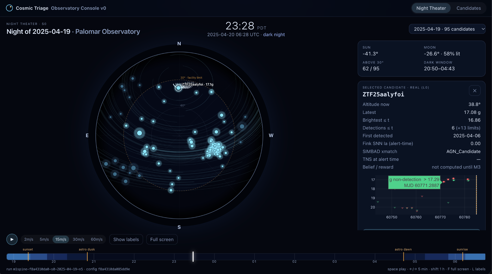
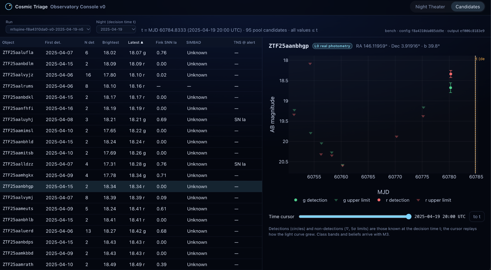
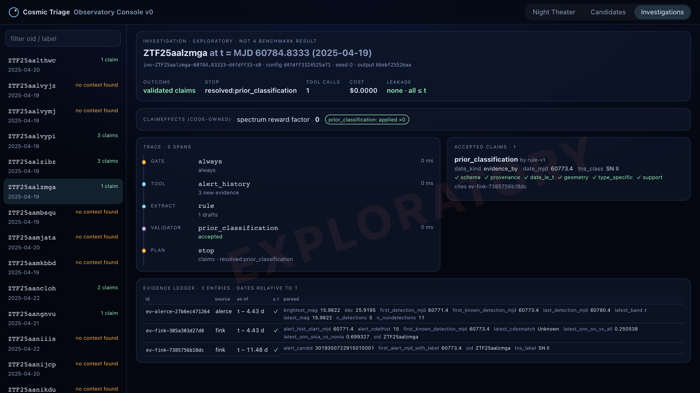
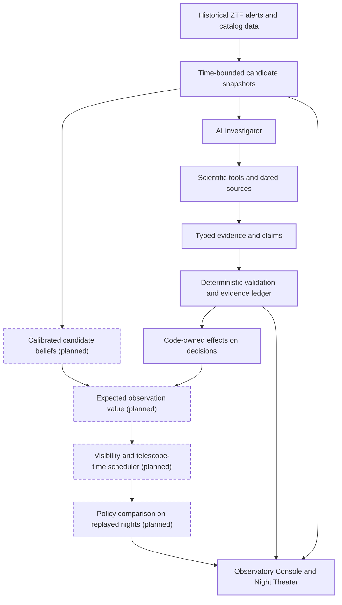

# Cosmic Triage

**Cosmic Triage is an AI-powered astronomical investigation and decision-support system that combines real telescope-survey data, tool-using agents, evidence verification, and historical replay to determine which objects deserve scarce follow-up observations.**

**The problem.** Sky surveys such as the Zwicky Transient Facility (ZTF) report far more new transient candidates every night than follow-up telescopes can observe. Some are exploding stars worth a spectrum. Others are variable stars, active galaxies, asteroids, or artifacts, and some were already classified by another team hours earlier. Every night, someone has to decide which few candidates get the telescope.

**The system.** Cosmic Triage replays real ZTF nights and sends candidates to an **Investigator**. This is a code-owned agent loop with six scientific tools. Every claim it makes must cite dated evidence in an EvidenceLedger and pass a deterministic validator chain before it can influence a decision. An interactive **Observatory Console** replays the night at Palomar and shows each investigation step by step.

**The question.** For each decision in the loop, which approach gives the best quality for its latency and cost: a large general-purpose LLM, a specialized decision model, or plain deterministic code? Each model (Claude for structured extraction, TypeSafe's Jev for bounded judgments such as gating and claim-support checks) sits in a swappable slot alongside a deterministic baseline, so its contribution can be measured rather than assumed.

**The engineering challenge.** Decisions must be historically honest. Each candidate is judged at a past decision time *t*, using only what was known then. A detection is excluded if it was delivered in a later alert, and catalog entries or reports dated after *t* are filtered out at the tool layer. Adversarial leakage fixtures enforce this on every test run.

**Implemented system:** A six-tool AI Investigator with an evidence ledger, deterministic claim validation, and bounded execution; historical replay of real ZTF observations with safeguards against future-data leakage; and an interactive Observatory Console for inspecting candidates, investigations, and their decision effects. Claude and Jev integrations are in place for controlled evaluation, with live model comparisons and telescope scheduling planned next ([status](#project-status)).

## See it in action



*Night Theater: a replay of the night of 2025-04-19 at Palomar, with candidates moving across the sky. The selected supernova candidate shows its track, its altitude, and what was known at decision time.*



*Candidate Explorer: the candidate pool at decision time t. Every value shown was known at or before t; circles are detections and triangles are non-detection limits.*



*Investigation trace for the same object: Fink's alert-time record shows it was already classified as SN II 11.5 days before t. The claim passes all six validation checks, and code sets that candidate's spectrum reward factor to 0. This is an exploratory run, not a benchmark.*

The telescope is simulated; the ZTF observations are real and historical.

## How it works



*Solid boxes are implemented; dashed boxes are planned for M3–M4. Beliefs are currently an uncalibrated stub. The only decision effect implemented so far is the spectrum-reward adjustment for objects already classified at t.*

**The AI does not get to invent a probability or directly command a telescope.** Models can decide *what to investigate*, call tools, and propose evidence-backed claims. Before an accepted claim can influence a decision, deterministic code checks:

- provenance
- dates
- object associations
- claim structure

The scientific decision layer owns probabilities, reward calculations, and scheduling.

A key design constraint is **historical information availability**. An observation made before a simulated decision is not necessarily usable: it might only have been delivered in a later alert. The replay distinguishes when a measurement was taken from when an alert made it available. This matters because an apparent improvement from an AI system is meaningless if it secretly saw the future. Adversarial leakage fixtures (`tests/leakage/`) check this boundary on every test run.

## The Investigator

The Investigator is a bounded, tool-using system designed to turn heterogeneous astronomical data into traceable, validated claims. It separates model judgments from scientific evidence and code-owned decision logic, allowing different decision models to be evaluated without changing the surrounding architecture.

- **Six typed scientific tools.** Each filters its output to what was known at the replay time t:
  - alert history
  - classification-report lookup
  - Lasair/Sherlock host context
  - SIMBAD cone search
  - ALeRCE image cutouts
  - a host-offset and absolute-magnitude calculator
- **A code-owned agent loop:** gate → plan → call tools → extract candidate claims → validate → store evidence. It has hard limits on tool calls, model calls, tokens, wall time, and spending, and explicit stop rules.
- **Evidence provenance.** Accepted claims cite records in an EvidenceLedger. The validator chain checks schema, provenance, date ≤ t, geometry recomputed from the cited coordinates, type-specific rules, and value support.
- **Swappable decision components.** A rule-based extractor and a deterministic verifier provide the executable baseline. Claude structured extraction and TypeSafe's **Jev** gate/verifier are integrated behind feature flags for later tests of extraction, investigation gating, and claim-support verification.
- **A hard spending cap.** Every live model call passes through `SpendGuard`. It enforces a lifetime cap of $20 and refuses all paid calls until the owner sets `approved` in `configs/investigator/budget.yaml`.
- **Inspectable traces.** Each investigation writes a JSONL trace. The console's Investigations tab shows tool calls, evidence dated relative to t, accepted and rejected claims, and outcomes.

One example of the intended behavior: if a candidate was **already classified before the decision time**, validated evidence reduces the value of requesting another classification spectrum. This effect is implemented. In a future version, identifying an existing active galaxy could change which hypotheses deserve investigation. These decisions must be grounded in records, not generated explanations alone.

## Project status

| Area | Status |
|---|---|
| ZTF/ALeRCE/Fink ingestion, Lasair and catalog clients, local response cache | **Implemented and tested** |
| Historical candidate snapshots and known-at-t leakage protections (37 adversarial fixtures) | **Implemented and tested**; scientific review of filtering policy ongoing |
| Observatory Console: Night Theater S0, Candidate Explorer, Investigations view | **Implemented** (plays saved replay artifacts) |
| Six-tool Investigator, EvidenceLedger, validator chain, rule-based extractor, orchestrator, traces, spend cap | **Implemented and tested** offline (44 Investigator tests) |
| Claude structured extractor; Jev gate and support verifier | **Implemented; awaiting live API validation.** Off by default; tested only against explicit test doubles; no paid calls made |
| Direct TNS report-date lookup | **Implemented but unverified; blocked** on TNS bot credentials. A Lasair-TNS discovery-report fallback is used meanwhile |
| 20-candidate exploratory Investigator batch | **Experimental** (deterministic slots only; not a benchmark) |
| Calibrated beliefs, objective-specific rewards, constraint-based nightly scheduler, telescope playback | **Planned (M3)** |
| Agent-versus-baseline benchmarks; model cost/quality comparisons | **Planned (M4+)** |

The offline test suite has 239 tests and makes no network calls.

## Evaluation status and scientific considerations

- **The Investigator has so far run in deterministic mode only.** In a 20-candidate exploratory batch it:
  - stayed within budget on every run
  - accepted 19 claims, none citing evidence dated after t
  - ended each run with validated claims or an explicit `no_context_found`
  - flagged 2 candidates as already classified at t

  This is a smoke test, not a benchmark. Claude and Jev have not yet been called live, and comparative model benchmarks have not been run.
- **Upstream candidate recall is 59.4% (85 of 143 object-nights).** This measures the replay's bright-transient candidate filter: which real, bright BTS transients reach the Investigator at all. It is *not* a measure of Jev accuracy, agent reasoning quality, or claim verification. Part of the shortfall comes from deliberately conservative historical-detection rules. For example, older unrelated activity at a supernova's position can make it look too old for the 14-day window.
- **Open scientific issues:**
  - filtering known asteroids, which make up 28 of 50 provisional contaminants
  - historical availability of host-galaxy associations, which are currently treated as static
  - contaminant labels that are provisional until a 30-object human audit
  - TNS classification report dates, which await TNS bot access. Fink's alert-time labels are used only as tool evidence, never as ground truth.

Detailed failure analyses, per-miss attributions, error categories (including one bug found and fixed in hand review), and the unresolved scientific decisions are in [`runs/reports/M1.1.md`](runs/reports/M1.1.md) and [`runs/reports/M2.md`](runs/reports/M2.md).

## What we're testing next

1. **Finish input-data audits.** Resolve the candidate-recall and known-asteroid filtering questions, complete the label audit, and strengthen historical-availability checks.
2. **Run real model comparisons.** Exercise Claude's structured extractor and Jev's bounded semantic judgments under the hard spending cap. Compare them with the deterministic baselines, including mistakes and latency.
3. **Make telescope decisions.** Calibrate candidate beliefs, assign objective-specific observation value, and schedule targets under altitude, Moon, exposure-time, and night-length constraints.
4. **Evaluate decisions, not just answers.** Replay the same historical nights with and without the Investigator. Measure wasted spectra, selection yield, calibration, costs, and failure modes. Keep simulated telescope outcomes clearly labeled.
5. **Explore efficient agent systems.** Test model cascades, context selection, persistent evidence memory, and reliability under tool failures.

The project follows two separate tracks. Exploratory runs (`runs/exploratory/`) support development and demos; only the controlled benchmark track will support performance claims.

## Run locally

**Requirements:** Python 3.12, [`uv`](https://docs.astral.sh/uv/), and Node.js 18+ with npm. The automated tests use recorded fixtures and run offline. Rebuilding data or running new investigations needs internet access to public astronomy services.

```bash
# From the repository root
uv sync
uv run pytest            # 239 offline tests; network access is blocked inside the suite
```

Launch the API:

```bash
uv run uvicorn cosmic_triage.api.app:app --port 8000
```

In a second terminal, launch the console. The Vite dev server proxies `/api` and `/theater` to port 8000.

```bash
cd console
npm install
npm run dev
```

Open **http://127.0.0.1:5173** and switch between **Night Theater**, **Candidates**, and **Investigations**.

### What works from a fresh clone

The repository includes the saved replay artifacts in `runs/`: five replayed nights (2025-04-19 to 2025-04-23) and the 20 exploratory investigation traces. The console and API work from a fresh clone with no credentials and no data download.

The raw API response cache (`data/cache/`) is **not** committed because it is large and fully regenerable. As a result:

- `scripts/demo_investigate.py <OID> <MJD> --offline` and the `scripts/accept_M*.py` acceptance checks need a warmed local cache. From a fresh clone they stop with an explicit `OfflineCacheMiss` rather than touching the network.
- Without `--offline`, the demo fetches from public services. The first run for a night builds that night's candidate pool, which means thousands of object queries to ALeRCE and Fink and can take tens of minutes. Later runs are served from the cache.

  ```bash
  uv run python scripts/demo_investigate.py ZTF25aankqhe 60788.8333333333   # 2025-04-23 20:00 UTC
  ```

- To rebuild the replay data from scratch, run `uv run python scripts/build_pool.py` (forward pools, which warms the cache) and then `uv run python scripts/run_m1_spine.py` (snapshots and Night Theater artifacts).

### API configuration

Copy `.env.example` to `.env` and fill in only the services you intend to use. **Never commit `.env` or API keys.**

| Variable | Used for | Without it |
|---|---|---|
| `LASAIR_TOKEN` (free) | Sherlock host context, Lasair-TNS discovery fallback | Those tools report themselves unavailable; other tools still run |
| `TNS_BOT_ID`, `TNS_BOT_NAME`, `TNS_API_KEY` (free bot registration) | Classification report dates | Report dates are marked blocked; the Lasair fallback supplies discovery reports only |
| `ANTHROPIC_API_KEY` (paid) | Claude structured extractor (off by default) | Rule-based extractor is used |
| `TYPESAFE_API_KEY` or `OPENROUTER_API_KEY` (paid) | Jev gate and support verifier (off by default) | Deterministic gate and verifier are used |
| `ADS_TOKEN` (optional) | Literature grounding (planned) | No effect yet |

Paid model calls stay disabled even when keys are present. Enabling them requires setting the feature flags in `configs/investigator/investigator.yaml` **and** setting an explicit approval in `configs/investigator/budget.yaml`. The per-token prices in that file are assumptions; check them against current provider pricing before approving spend.

## Architecture and reproducibility

- [`docs/ARCHITECTURE.md`](docs/ARCHITECTURE.md) is the authoritative design. It covers the scientific assumptions, data boundaries, milestones, and evaluation plan.
- `src/cosmic_triage/` holds the Python packages:
  - `contracts` (typed pydantic schemas)
  - `ingest` (cached clients)
  - `replay` (time-bounded snapshots and truth labels)
  - `investigator`
  - `belief`, `value`, and `schedule` (early decision-layer stubs)
  - `api`
- [`console/`](console/) is the React/TypeScript Observatory Console. It only plays replay artifacts and performs no science in the UI.
- `tests/` contains the offline contract, leakage, unit, and Investigator tests. `scripts/accept_M*.py` are the milestone acceptance checks.
- Import-linter contracts in `pyproject.toml` enforce the data boundaries. For example, only `replay` may read truth labels, and the Investigator never reads the raw cache.
- Every run records its seed, config hash, and output hash. Identical inputs reproduce identical output hashes.
- [`runs/reports/`](runs/reports/) records milestone outcomes ([M0](runs/reports/M0.md), [M1](runs/reports/M1.md), [M1.1](runs/reports/M1.1.md), [M2](runs/reports/M2.md)), open scientific questions, and known limitations.
- **Engineering process.** The design evolved through written reviews (`docs/REVIEW-*.md`) and was implemented milestone by milestone with Claude Code, following `CLAUDE.md`. "Fable" and "Opus" in those documents are the Claude models used as design reviewer and implementer. Each milestone report lists the decisions made and the questions escalated for review.

## Data sources and acknowledgments

This project relies on public astronomy data and services:

- the [Zwicky Transient Facility](https://www.ztf.caltech.edu/) public alert stream and [Bright Transient Survey](https://sites.astro.caltech.edu/ztf/bts/)
- the [ALeRCE](https://alerce.science/), [Fink](https://fink-broker.org/), and [Lasair](https://lasair-ztf.lsst.ac.uk/) brokers
- [SIMBAD](https://simbad.cds.unistra.fr/) (CDS, Strasbourg) and the [NASA/IPAC Extragalactic Database](https://ned.ipac.caltech.edu/)
- the [Transient Name Server](https://www.wis-tns.org/)

`tests/fixtures/` holds a small number of recorded broker and catalog query responses used as offline test fixtures. The text-corpus fixtures (GCN, ATel, and AstroNotes) are synthetic and generated by `scripts/make_corpus_fixtures.py`, so no published third-party text is redistributed. `runs/` holds derived replay artifacts. Please follow each provider's acknowledgment and usage policies if you reuse the data.

The project's goal is an **auditable answer** to a practical AI-systems question: *when does a grounded, budgeted, tool-using agent actually make a better decision than simpler software?*
